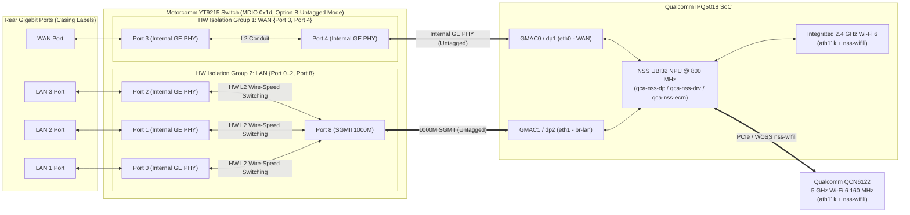

# Xiaomi AX3000 (RA80 v2) — OpenWrt with QSDK NSS Hardware Offload

[中文](README.md) | **English**

Qualcomm **NSS (NPU) full hardware offload** for the **Xiaomi AX3000 (RA80 v2)** (`xiaomi,ax3000-v2`: Qualcomm IPQ5018 + QCN6122 + Motorcomm YT9215 switch) on an **OpenWrt 25.12.5 baseline** (Linux 6.12.94, 64-bit `aarch64`). All NSS drivers come from Qualcomm's official QSDK 14.0 sources.

Both wired forwarding (WAN ↔ LAN) and dual-band Wi-Fi (2.4 GHz + 5 GHz 160 MHz `nss-wifili`) run inside the NSS NPU cores without taxing the host Cortex-A53 CPU.

Every successful build on `main` publishes a [Release](../../releases) with three firmware images:

| File | Purpose |
|---|---|
| `*-squashfs-sysupgrade.bin` | Upgrading a router already running large-partition OpenWrt: `sysupgrade -n` |
| `*-squashfs-factory.ubi` | Flashing via the **large-partition U-Boot** web recovery UI or `ubiformat` |
| `*-initramfs-FitImage.itb` | RAM-bootable FIT image via U-Boot `tftpboot` (does not touch flash) |

---

## Hardware & Switch Architecture

### 1. Hardware Specifications

| Component | Specification |
|---|---|
| SoC | Qualcomm IPQ5018 (Dual-core Cortex-A53 @ 1.0 GHz + Single-core NSS UBI32 NPU @ 800 MHz) |
| RAM / Flash | 256 MB DDR3L / 128 MB SPI-NAND (**Large-partition layout**: `ubi_kernel` 30 MB + `rootfs` 87.5 MB) |
| 2.4 GHz Wi-Fi | IPQ5018 integrated 2x2 Wi-Fi 6 (`ath11k` + `nss-wifili` hardware offload) |
| 5 GHz Wi-Fi | Qualcomm QCN6122 2x2 Wi-Fi 6 160 MHz (`ath11k` + `nss-wifili` hardware offload) |
| Gigabit Switch | Motorcomm YT9215 (MDIO address `0x1d`, hardware reset `GPIO 39`) |

### 2. YT9215 Untagged Dual-Conduit Architecture (Option B)

On the Xiaomi AX3000 (RA80 v2), the Motorcomm YT9215 switch connects **Port 4 (Internal GE PHY)** and **Port 8 (1000M SGMII)** to the two independent hardware GMACs on the IPQ5018:



Why not use a DSA driver:
- In DSA mode, YT9215 prepends a proprietary 8-byte `0x9988` CPU tag to every frame and creates virtual DSA slave netdevs (`lan1..lan3`, `wan`).
- Qualcomm's NSS data plane (`qca-nss-dp`) and connection manager (`qca-nss-ecm`) operate on the physical GMAC interfaces (`eth0` / `eth1`) and cannot parse Motorcomm's proprietary `0x9988` DSA tag in hardware.

Instead, this build initializes the YT9215 switch via [`yt9215-ra80v2.c`](openwrt/tree/target/linux/qualcommax/files/drivers/net/phy/yt9215-ra80v2.c) in **Option B (Untagged Dual-Conduit Hardware-Isolated Mode)**:
- **Proprietary CPU tag disabled** (`0x8000c = 0x0`): all frames entering and leaving `eth0` and `eth1` are standard untagged Ethernet frames (MTU 1500).
- **Hardware Port Isolation Matrix** (`0x180294 + p*4`):
  - **WAN Conduit**: Rear WAN (Port 3) and Internal PHY Port 4 (`dp1` / `eth0`) form an isolated hardware forwarding group `{3, 4}`, with physical Port 3 link state mirrored onto `eth0` carrier.
  - **LAN Conduit**: Rear LAN 1..3 (Ports 0..2: LAN 1 = Port 0, LAN 2 = Port 1, LAN 3 = Port 2) and SGMII Port 8 (`dp2` / `eth1` / `br-lan`) form an isolated hardware L2 switching group `{0, 1, 2, 8}`.
- **100% NSS Hardware Offload**: `eth0` (WAN) and `eth1` (LAN) are driven directly by `qca-nss-dp`, enabling full wire-speed NSS acceleration for NAT, PPPoE, bridging, and dual-band Wi-Fi (`nss-wifili`).

For the complete official Motorcomm YT9215 register and bitfield database (extracted from `tbl_reg_list` in Xiaomi stock firmware `1.0.34`'s `yt_switch.ko`), see [**`YT9215_REGISTERS.md`**](YT9215_REGISTERS.md).

---

## Default Configuration

| Setting | Default Value | Notes |
|---|---|---|
| LAN IP Address | `192.168.31.1` | Subnet mask `255.255.255.0` |
| Hostname | `Xiaomi-AX3000` | No default password for LuCI / SSH (`root`) |
| Network Interfaces | `eth1` → `br-lan` (LAN 1..3)<br>`eth0` → `wan` / `wan6` (WAN) | Configured automatically via `02_network` |
| 2.4 GHz Wi-Fi | `Xiaomi-AX3000-2.4G-XXXX` | Open / no encryption (`encryption 'none'`), `HE40`, country `CN` |
| 5 GHz Wi-Fi | `Xiaomi-AX3000-5G-XXXX` | Open / no encryption (`encryption 'none'`), Channel 36 **`HE160` (160 MHz)** |
| LuCI Language | Simplified Chinese (`zh_cn`) | Can be switched to English under System → Language and Style |

> `XXXX` is the last two bytes of the device's MAC address (uppercase), set on first boot by `/etc/uci-defaults/97-pzl8-wifi-ssid`.
>
> **Important Notes:**
> 1. Both Wi-Fi bands ship with open encryption (`none`) for out-of-the-box access. Set a WPA2/WPA3 password in LuCI (Network → Wireless) immediately after flashing.
> 2. Because 5 GHz defaults to **160 MHz (`HE160`)** under country code `CN`, it spans DFS radar channels. **On every boot or radio restart, `hostapd` performs a 60-second DFS Channel Availability Check (CAC)** before broadcasting the 5 GHz SSID (2.4 GHz comes up immediately). Switch to `HE80` if you prefer instant 5 GHz startup without DFS wait.

---

## Flashing

> [!IMPORTANT]
> **Prerequisite: Large-Partition U-Boot Required**
> This firmware uses the **large-partition layout** (starting at `0xa80000`: `ubi_kernel` 30 MB + `rootfs` 87.5 MB, matching community large-partition OpenWrt builds for RA80 v2).
> If your router is still on Xiaomi's stock bootloader / dual-rootfs partition layout, **you must first unlock SSH and flash the large-partition U-Boot for Xiaomi AX3000 (RA80 v2)** before flashing this firmware.

### 1. Flashing via Large-Partition U-Boot Web Recovery (First Install / Switching Layouts)

1. Hold the Reset button while powering on the router to enter the large-partition U-Boot web recovery page;
2. Upload **`*-squashfs-factory.ubi`** from the Release assets and wait for the router to reboot automatically.

### 2. Upgrading from Large-Partition OpenWrt / This Build

Upload via LuCI (System → Backup / Flash Firmware) or run `sysupgrade` over SSH with **`*-squashfs-sysupgrade.bin`**:

```sh
sysupgrade -n openwrt-qualcommax-ipq50xx-xiaomi_ax3000-v2-squashfs-sysupgrade.bin
```

---

## Features & Debugging

### Included Features
- **Full NSS Offload Stack**: `qca-nss-drv` + `qca-nss-ecm` + `qca-nss-dp` + `ath11k` `nss-wifili` (wired NAT/PPPoE/bridge + 2.4G/5G Wi-Fi hardware offload)
- **YT9215 Option B Driver (`yt9215-ra80v2`)**: zero DSA tag overhead, dual independent GMAC conduits, hardware port isolation
- **Fullcone NAT**: integrated via [openwrt-sonic-fullcone](https://github.com/mufeng05/openwrt-sonic-fullcone) in CI builds (disabled by default; enable in Network → Firewall → General Settings and the `wan` zone, fully NSS-accelerated)
- **LuCI Hardware Status Section**: displays CPU frequency, CPU/Wi-Fi temperatures, **NSS core load**, **accelerated connection count**, and live per-port WAN/LAN throughput on the Status → Overview page
- **Argon Theme**: `luci-theme-argon` bundled in CI builds

### Diagnostic Commands

1. **Inspect live YT9215 switch registers and per-port MIB counters**:
   ```sh
   cat /sys/kernel/debug/yt9215_regs
   ```
   Read or write any 32-bit YT9215 register at runtime:
   ```sh
   # Read register 0x18038c
   echo "0x18038c" > /sys/kernel/debug/yt9215_regs
   head -n 1 /sys/kernel/debug/yt9215_regs

   # Write register
   echo "0x180508 0x0" > /sys/kernel/debug/yt9215_regs
   ```
2. **Check NSS NPU load and ECM accelerated connections**:
   ```sh
   cat /sys/kernel/debug/qca-nss-drv/stats/cpu_load_ubi
   cat /sys/kernel/debug/ecm/ecm_db/connection_count
   cat /sys/kernel/debug/ecm/ecm_nss_ipv4/accelerated_count
   ```

---

## Building

### 1. GitHub Actions

Every push to `main` or manual dispatch of **Build Xiaomi AX3000 (RA80 v2) (NSS)** builds the firmware with `ccache` + toolchain caching and publishes a Release.

### 2. Local Build

```sh
git clone https://github.com/openwrt/openwrt -b v25.12.5
git clone <this-repo-url> ra80v2-nss
ra80v2-nss/scripts/setup.sh ./openwrt
cd openwrt && make -j$(nproc)
```

To customize packages:

```sh
cd openwrt
make menuconfig
make -j$(nproc)
```

> **Required Kconfig symbols** (automatically verified after `make defconfig` in CI):
> - `CONFIG_NSS_DRV_WIFIOFFLOAD_ENABLE=y`
> - `CONFIG_NSS_FIRMWARE_VERSION_12_5=y`
> - `CONFIG_PACKAGE_kmod-qca-nss-drv=y`
> - `CONFIG_PACKAGE_nss-firmware-ipq50xx=y`
> - `CONFIG_LUCI_LANG_zh_Hans=y`

To save your updated configuration back to the seed file:

```sh
cd openwrt
./scripts/diffconfig.sh > ../ra80v2-nss/config/xiaomi_ra80v2.config
```

---

## Repository Layout

```
YT9215_REGISTERS.md  Complete official Motorcomm YT9215 register & bitfield reference
config/              OpenWrt .config seed (xiaomi_ra80v2.config)
feed/                QSDK 14.0 / 12.5.5 NSS packages (qca-nss-drv, qca-nss-ecm, qca-nss-clients,
                     qca-mcs, nss-firmware, nss-wifili-probe, ipq-wifi-xiaomi_ax3000-v2)
files/               rootfs overlay: nss-offload init scripts, LuCI hardware status, uci-defaults
manifest/            Pinned Qualcomm QSDK 14.0 source revisions
openwrt/
  0001-*.patch       Platform and driver patches against the OpenWrt baseline
  tree/              New kernel files and DTBs (ipq5018-xiaomi-ax3000-v2.dts, yt9215-ra80v2.c, etc.)
  feeds/             Patches for luci and packages feeds
scripts/setup.sh     Idempotently applies everything above to a clean OpenWrt v25.12.5 tree
```

---

## Credits & License

- Qualcomm QSDK sources from <https://git.codelinaro.org/clo/qsdk>.
- Community NSS packaging, kernel 6.x adaptations, and LuCI hardware status integration:
  - [mufeng05/openwrt-cmcc-pz-l8-nss](https://github.com/mufeng05/openwrt-cmcc-pz-l8-nss) & [mufeng05/openwrt-sonic-fullcone](https://github.com/mufeng05/openwrt-sonic-fullcone)
  - [JuliusBairaktaris](https://github.com/JuliusBairaktaris) (`nss-packages` / `openwrt-nss-edma`)
  - [kuncy7](https://github.com/kuncy7)
  - [qosmio/qca-sdk-nss-fw](https://github.com/qosmio/qca-sdk-nss-fw)
  - [hzyitc/openwrt-redmi-ax3000](https://github.com/hzyitc/openwrt-redmi-ax3000)
- This repository's own code (`yt9215-ra80v2.c`, `ipq5018-xiaomi-ax3000-v2.dts`, `ipq5018-nss.dtsi`, etc.) is licensed under [GPL-2.0-only](LICENSE); individual patches and files are governed by their `SPDX-License-Identifier` headers.
