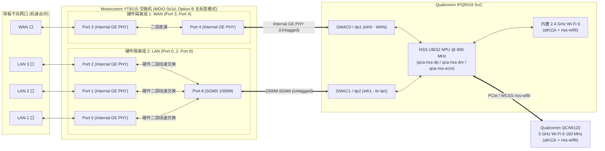

# Xiaomi AX3000 (RA80 v2) — 带 QSDK NSS 硬件卸载的 OpenWrt

**中文** | [English](README.en.md)

在 **OpenWrt 25.12.5 基线**（Linux 6.12.94，64 位 `aarch64`）上为 **小米 AX3000 (RA80 v2)**（`xiaomi,ax3000-v2`：高通 IPQ5018 + QCN6122 + 裕太微 YT9215 交换机）启用高通 **NSS (NPU) 全链路硬件卸载**。所有 NSS 驱动直接取自高通官方 QSDK 14.0 源码。

有线（WAN ↔ LAN）与双频 Wi-Fi（2.4 GHz + 5 GHz 160 MHz `nss-wifili`）的数据包转发均在 NSS 核内完成，无需经过主 CPU。

`main` 分支每次构建成功会自动发布一个 [Release](../../releases)，包含以下固件文件：

| 文件 | 用途 |
|---|---|
| `*-squashfs-sysupgrade.bin` | 在已刷入大分区 OpenWrt 的路由器上升级：`sysupgrade -n` |
| `*-squashfs-factory.ubi` | 在 **大分区 U-Boot（112M 布局）** Web 恢复页面或通过 `ubiformat` 刷入 |
| `*-initramfs-FitImage.itb` | U-Boot `tftpboot` 内存启动镜像（不写闪存，用于救砖或临时引导） |

---

## 硬件与架构设计

### 1. 硬件规格

| 组件 | 规格 |
|---|---|
| SoC | Qualcomm IPQ5018（双核 Cortex-A53 @ 1.0 GHz + 单核 NSS UBI32 NPU @ 800 MHz） |
| 内存 / 闪存 | 256 MB DDR3L / 128 MB SPI-NAND（**112 MB 大分区布局**：`ubi_kernel` 30 MB + `rootfs` 87.5 MB） |
| 2.4 GHz 无线 | IPQ5018 内置 2x2 Wi-Fi 6 (`ath11k` + `nss-wifili` 硬件卸载) |
| 5 GHz 无线 | Qualcomm QCN6122 2x2 Wi-Fi 6 160 MHz (`ath11k` + `nss-wifili` 硬件卸载) |
| 千兆交换机 | Motorcomm YT9215（MDIO 地址 `0x1d`，硬件复位 `GPIO 39`） |

### 2. YT9215 无标签双通道架构（Option B）

小米 AX3000 (RA80 v2) 使用裕太微 YT9215 交换机，其内部 **Port 4（内置千兆 PHY）** 与 **Port 8（1000M SGMII）** 同时连接到 IPQ5018 的两个独立硬件 GMAC：



为什么不使用 DSA 驱动：
- YT9215 在 DSA 模式下会向帧头插入 8 字节私有 `0x9988` CPU Tag，并创建 `lan1..lan3` / `wan` 虚拟子接口。
- 高通 NSS 数据平面（`qca-nss-dp`）与连接管理器（`qca-nss-ecm`）只认识物理 GMAC 接口 `eth0`/`eth1` 及标准以太网帧，无法硬件解析裕太微私有 `0x9988` DSA 标签。

因此本固件通过内核驱动 [`yt9215-ra80v2.c`](openwrt/tree/target/linux/qualcommax/files/drivers/net/phy/yt9215-ra80v2.c) 将 YT9215 初始化为 **Option B（无标签双通道硬件隔离模式）**：
- **关闭私有 CPU 标签**（`0x8000c = 0x0`），所有进出 `eth0` 与 `eth1` 的帧均为标准无标签以太网帧（MTU 1500）。
- **硬件级 WAN / LAN 隔离**（`0x180294 + p*4`）：
  - **WAN 通道**：背板 WAN 口（Port 3）与内部 PHY 口（Port 4 → `dp1` / `eth0`）直通，并自动将 Port 3 物理网线插拔状态同步至 `eth0` 载波状态。
  - **LAN 通道**：背板 LAN 1..3（对应交换机 Port 0..2：LAN 1 = Port 0、LAN 2 = Port 1、LAN 3 = Port 2）与 SGMII 口（Port 8 → `dp2` / `eth1` / `br-lan`）在交换芯片内部完成二层线速交换，并与 WAN 组完全隔离。
- **100% NSS 硬件加速**：`eth0`（WAN）与 `eth1`（LAN）直接由 `qca-nss-dp` 接管，配合 `qca-nss-ecm` 和 `ath11k` `nss-wifili` 实现有线 NAT/PPPoE 与双频 Wi-Fi 满速硬件卸载。

完整的 YT9215 寄存器与位域定义（提取自小米原厂 `1.0.34` 固件 `yt_switch.ko` 的 `tbl_reg_list`）见仓库根目录的 [**`YT9215_REGISTERS.md`**](YT9215_REGISTERS.md)。

---

## 默认配置

| 项目 | 默认值 | 说明 |
|---|---|---|
| 管理地址 (LAN IP) | `192.168.31.1` | 子网掩码 `255.255.255.0` |
| 主机名 | `Xiaomi-AX3000` | Web 界面与 SSH 默认无密码（`root`） |
| 有线接口映射 | `eth1` → `br-lan`（LAN 1..3）<br>`eth0` → `wan` / `wan6`（WAN） | 自动由 `02_network` 配置 |
| 2.4 GHz Wi-Fi | `Xiaomi-AX3000-2.4G-XXXX` | 开放无密码（`encryption 'none'`），`HE40`，国家码 `CN` |
| 5 GHz Wi-Fi | `Xiaomi-AX3000-5G-XXXX` | 开放无密码（`encryption 'none'`），36 信道 **`HE160` (160 MHz)** |
| Web 界面语言 | 简体中文 (`zh_cn`) | 首次启动默认设为中文，可在「系统 → 语言和界面」修改 |
| ZRAM 交换分区 | `86 MB` (`zstd` 压缩) | 默认由 `99-ra80v2-nss` 自动配置，缓解 256 MB 内存压力 |

> `XXXX` 为设备 MAC 地址后两字节（大写），首次启动时由 `/etc/uci-defaults/97-pzl8-wifi-ssid` 自动生成。
>
> **注意：**
> 1. 无线网络默认开放无密码，刷机完成后请第一时间在 LuCI（「网络 → 无线」）或通过 UCI 设置 Wi-Fi 密码。
> 2. 5 GHz 默认启用 **160 MHz (`HE160`)**，在中国区 (`CN`) 下跨越 DFS 雷达信道，因此**每次开机或重启 5G 射频后需等待约 60 秒 DFS 信道可用性检查（CAC）** 才会发出 5 GHz 信标（2.4 GHz 不受影响，开机立即可连）。若无需 160 MHz，可在无线设置中改为 `HE80` 实现秒开。

---

## 刷机指南

> [!IMPORTANT]
> **前置要求：需先刷入大分区 U-Boot**
> 本固件采用 **大分区布局**（`0xa80000` 起：`ubi_kernel` 30 MB + `rootfs` 87.5 MB，合计约 117.5 MB UBI 空间），与社区大分区 OpenWrt 固件分区表一致。
> 若路由器仍处于小米原厂 U-Boot / 原厂双分区布局，**必须先解锁 SSH 并刷入小米 AX3000 (RA80 v2) 专用大分区 U-Boot**，切勿在原厂小分区 U-Boot 下直接刷入本固件。

### 1. 通过大分区 U-Boot Web 页面刷入（推荐首次刷入或从其它分区布局切换）

1. 电脑网卡固定 IP（如 `192.168.1.2` 或对应大分区 U-Boot 网段），按住路由器 Reset 键通电进入大分区 U-Boot Web 恢复页面；
2. 选择本仓库 Release 中的 **`*-squashfs-factory.ubi`** 上传刷入，等待自动重启即可。

### 2. 已在大分区 OpenWrt / 本固件下升级

直接通过 LuCI（「系统 → 备份与升级」）或 SSH 使用 `sysupgrade` 刷入 **`*-squashfs-sysupgrade.bin`**：

```sh
sysupgrade -n openwrt-qualcommax-ipq50xx-xiaomi_ax3000-v2-squashfs-sysupgrade.bin
```

---

## 已启用特性与调试接口

### 已启用特性
- **NSS 双核 NPU 硬件卸载**：`qca-nss-drv` + `qca-nss-ecm` + `qca-nss-dp` + `ath11k` `nss-wifili`（有线 NAT / PPPoE / Bridge + 2.4G/5G 双频无线全卸载）
- **YT9215 Option B 驱动 (`yt9215-ra80v2`)**：无 DSA 标签开销、双 GMAC 独立通道、硬件端口隔离
- **Fullcone NAT（全锥形 NAT）**：CI 构建默认集成 [openwrt-sonic-fullcone](https://github.com/mufeng05/openwrt-sonic-fullcone)，在「网络 → 防火墙 → 常规设置」及 `wan` 区域中勾选即可开启，开启后同样受 NSS 硬件加速
- **LuCI 硬件状态面板**：在「状态 → 概览」页面实时展示处理器频率、CPU 温度、Wi-Fi 射频温度、**NSS 核心负载**、**NSS 加速连接数**以及 WAN/LAN 硬件端口实时吞吐量
- **Argon 主题**：CI 构建默认内置 `luci-theme-argon`

### 常用调试命令

1. **查看 YT9215 交换机实时寄存器与各端口 MIB 收发统计**：
   ```sh
   cat /sys/kernel/debug/yt9215_regs
   ```
   支持在线读写任意 32 位交换机内部寄存器：
   ```sh
   # 读取指定寄存器（例如 0x18038c）
   echo "0x18038c" > /sys/kernel/debug/yt9215_regs
   head -n 1 /sys/kernel/debug/yt9215_regs

   # 写入指定寄存器
   echo "0x180508 0x0" > /sys/kernel/debug/yt9215_regs
   ```
2. **查看 NSS NPU 负载与 ECM 硬件加速连接数**：
   ```sh
   cat /sys/kernel/debug/qca-nss-drv/stats/cpu_load_ubi
   cat /sys/kernel/debug/ecm/ecm_db/connection_count
   cat /sys/kernel/debug/ecm/ecm_nss_ipv4/accelerated_count
   ```

---

## 编译构建

### 1. GitHub Actions 自动构建

推送到 `main` 分支或手动触发 **Build Xiaomi AX3000 (RA80 v2) (NSS)** 工作流即可自动编译并发布 Release。工作流已内置 `ccache` 与工具链缓存。

### 2. 本地编译

```sh
git clone https://github.com/openwrt/openwrt -b v25.12.5
git clone <本仓库地址> ra80v2-nss
ra80v2-nss/scripts/setup.sh ./openwrt
cd openwrt && make -j$(nproc)
```

如需自定义软件包：

```sh
cd openwrt
make menuconfig
make -j$(nproc)
```

> **切勿关闭的关键配置项**（CI 会在 `make defconfig` 后自动校验）：
> - `CONFIG_NSS_DRV_WIFIOFFLOAD_ENABLE=y`
> - `CONFIG_NSS_FIRMWARE_VERSION_12_5=y`
> - `CONFIG_PACKAGE_kmod-qca-nss-drv=y`
> - `CONFIG_PACKAGE_nss-firmware-ipq50xx=y`
> - `CONFIG_LUCI_LANG_zh_Hans=y`

如需将修改后的配置保存回仓库种子文件：

```sh
cd openwrt
./scripts/diffconfig.sh > ../ra80v2-nss/config/xiaomi_ra80v2.config
```

---

## 目录结构

```
YT9215_REGISTERS.md  从原厂 1.0.34 提取的 YT9215 官方完整寄存器与位域速查表
config/              OpenWrt .config 种子配置 (xiaomi_ra80v2.config)
feed/                QSDK 14.0 / 12.5.5 NSS 软件包 (qca-nss-drv, qca-nss-ecm, qca-nss-clients,
                     qca-mcs, nss-firmware, nss-wifili-probe, ipq-wifi-xiaomi_ax3000-v2)
files/               rootfs 覆盖层：nss-offload 启动脚本、LuCI 硬件状态面板、UCI 默认初始化脚本
manifest/            锁定的高通 QSDK 14.0 源码版本
openwrt/
  0001-*.patch       针对 OpenWrt 基线的平台与驱动补丁
  tree/              新增的内核文件与设备树（ipq5018-xiaomi-ax3000-v2.dts、yt9215-ra80v2.c 等）
  feeds/             针对 luci / packages feed 的补丁
scripts/setup.sh     将本项目幂等地应用到干净的 OpenWrt v25.12.5 源码树
```

---

## 致谢与许可

- 高通 QSDK 源码来自 <https://git.codelinaro.org/clo/qsdk>。
- NSS 社区移植、内核 6.x 适配与 LuCI 硬件状态框架参考并致谢：
  - [mufeng05/openwrt-cmcc-pz-l8-nss](https://github.com/mufeng05/openwrt-cmcc-pz-l8-nss) 与 [mufeng05/openwrt-sonic-fullcone](https://github.com/mufeng05/openwrt-sonic-fullcone)
  - [JuliusBairaktaris](https://github.com/JuliusBairaktaris) (`nss-packages` / `openwrt-nss-edma`)
  - [kuncy7](https://github.com/kuncy7)
  - [qosmio/qca-sdk-nss-fw](https://github.com/qosmio/qca-sdk-nss-fw)
  - [hzyitc/openwrt-redmi-ax3000](https://github.com/hzyitc/openwrt-redmi-ax3000)
- 本仓库自有代码（包括 `yt9215-ra80v2.c`、`ipq5018-xiaomi-ax3000-v2.dts`、`ipq5018-nss.dtsi` 等）采用 [GPL-2.0-only](LICENSE) 许可，各补丁与组件以文件头部的 `SPDX-License-Identifier` 为准。
